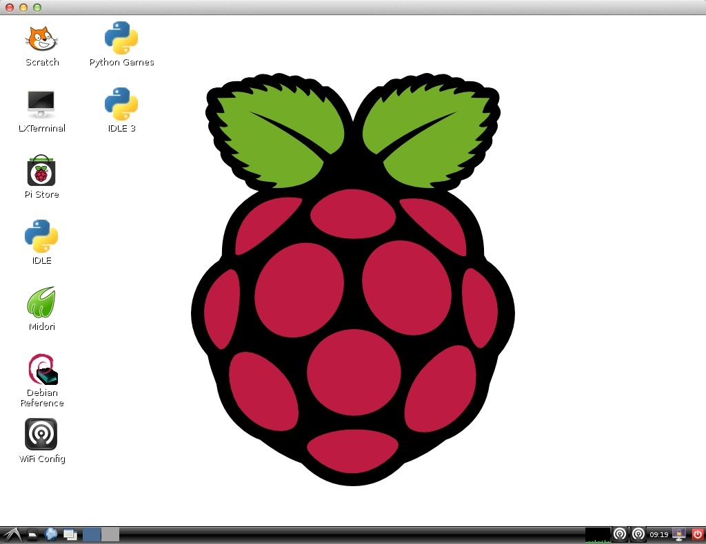

# 树莓派文档归档

## 阅读入口

- [在线阅读](https://flyher.github.io/shumeipai/)

这是一个 Raspberry Pi 资料归档项目，共收录 113 篇文章。

项目在保留原始网页的同时，提供重新排版的整理版，并尽可能将文章引用的图片和必要附件保存在仓库中。

> 但是这些文章大多整理于 2014 年前后，部分命令、软件版本和下载地址可能已经失效，连当初援引的站点也不复存在了。不管怎么样，趁着 2026年 AI Coding 的流行，用 codex 批量整理了剩下的 markdown 页面，也算是为当年的树莓派收了尾吧。

## 版本说明

- **整理版**：按照目录序号重新排版，尽可能使用本地资源，适合直接阅读。
- **原始页**：保留归档时的 HTML 页面，用于核对原文和旧版页面结构。

每篇整理版文章顶部提供“返回文档目录”和“查看原始页”入口。没有对应原始页面时，会显示“原始页缺失”。

## 目录说明

- `md/`：整理版文章，文件名以文章序号开头。
- `content/`：原始 HTML 页面。
- `src/`：文章引用的本地图片和附件，按文章序号分目录保存。
- `js/`：整理版页面使用的本地脚本和样式。
- `pdf/`：历史 PDF 资料。
- `tools/`：文档迁移和资源整理脚本。

## 更新日志

### 2026-10-20

- 按原目录顺序整理并生成 113 篇文章。
- 合并重复的原始文章目录，统一保存在 `content/`。
- 为整理版文章增加原始页面对照入口。
- 将可用的图片和必要附件整理到 `src/<序号>/`。
- 清理重复资源、空目录和异常下载文件。
- 对失效或不适合本地化的资源保留外链说明。
- 修复第 1 至第 4 篇文章正文丢失的问题。
- 重新设计文章目录，增加标题和序号搜索。
- 统一文章导航、版本名称和首页版权显示。

### 2014-07-04

- 更新文章栏目。

### 2014-06-23

- 开始整理 Markdown 版本。

### 2014-04-26

- 增加两份 PDF 资料。
- 当时归档资料共 114 篇。

### 2014-04-23

- 删除重复资源。
- 增加文章索引。

## 声明

本项目收录的文章大部分来自互联网，仅用于资料整理、历史归档和学习参考。

如果你是原作者，需要补充来源、修改版权链接或删除相关内容，请通过 GitHub Issue 联系。
